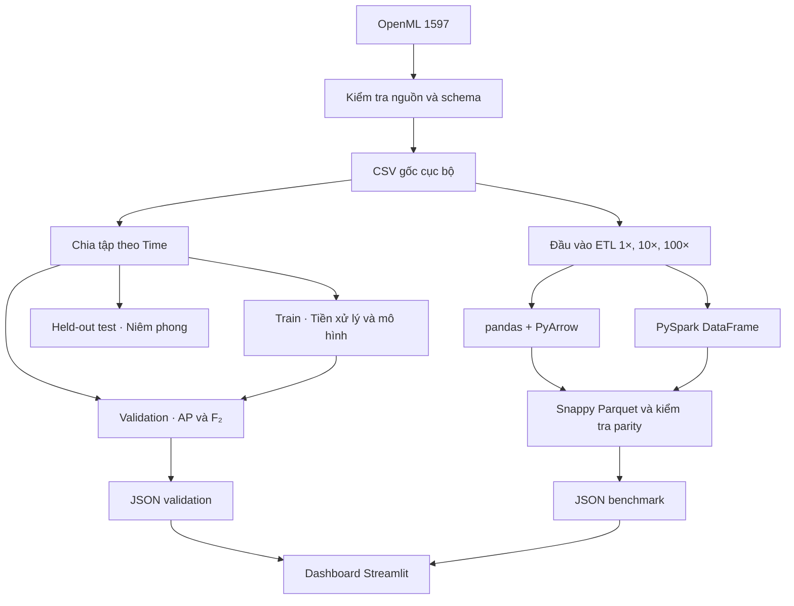

# Kiến trúc hệ thống

| Thành phần | Trách nhiệm và đầu ra |
| --- | --- |
| `scripts/phase_01_acceptance.py`, `src/fraud_detection/ingestion/` | Xác minh OpenML 1597 v1 và checksum ARFF, xuất CSV, chạy profiling và notebook Phase 1. |
| `src/fraud_detection/preprocessing/` | Chia theo nhóm `Time`, giữ bản ghi trùng trong cùng tập. Tạo thêm split grouped-stratified để tham chiếu độc lập. |
| `src/fraud_detection/models/`, `pipelines/train.py`, `evaluation/` | Huấn luyện 11 cấu hình mỗi protocol. Scaler và SMOTE học trên train. Chọn ngưỡng theo F₂ trên validation và xếp hạng candidate theo AP, rồi F₂ và tên cấu hình khi hòa. |
| `src/fraud_benchmarks/`, `scripts/phase_03_benchmark.py` | Tạo workload có `source_row_id` và `replica_id`, đo đọc CSV, thêm `hour` và ghi Snappy Parquet. Kiểm tra schema, độ phủ danh tính, tổng số fraud và histogram theo giờ/lớp sau khi đo. |
| `dashboard/`, `reports/phase_03/` | Streamlit đọc snapshot validation và ba báo cáo benchmark đã lưu. Tập test chỉ xuất hiện dưới dạng số lượng dòng/lớp trong bảng chia tập. |
| `.github/workflows/ci.yml` | Chạy test/lint, xác minh dữ liệu nguồn, tái lập validation, kiểm tra Spark ở 1× và chạy dashboard từ bản checkout sạch. |

## Môi trường triển khai

- **Demo cục bộ** dùng Streamlit và các JSON đã commit. Các tệp dưới `data/` và `artifacts/` phát sinh khi chạy lại nghiên cứu.
- **Spark local** dùng `local[2]` để đo hiệu năng trên một máy. Docker Compose chạy một master, hai worker và benchmark client dùng chung workspace trên một host. [Cấu hình Compose](../infra/docker/README.md)
- **GitHub Actions** chạy Phase 2 và Phase 3 sau khi có evidence Phase 1. Artifact công bố chứa số liệu, báo cáo và notebook đã chạy. Candidate và bộ test được quản lý theo [hồ sơ quyết định](phase_02_decision.md).

Xem [quy trình đánh giá mô hình](phase_02_protocol.md) và [quy trình benchmark](phase_03_benchmark.md) để biết công thức, tham số và giới hạn phép đo.
